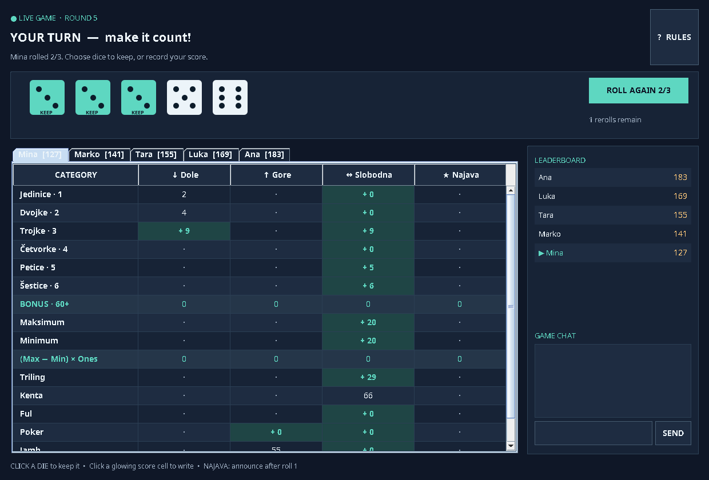

# JAMB — Java 8 / 5-Dice Starter for Trainees



A **working five-dice** Serbian Jamb game built using **Java 8 (JDK 8)**, **Java Swing**, and a TCP game server for **2–5 players**. No external Java libraries, Maven, or Gradle are needed.

**This is deliberately a FIVE-dice starter project.** Adding a *sixth die* is a hands-on exercise for trainees, **not already implemented**. The assignment is in [docs/TRAINEE-CHALLENGE.md](docs/TRAINEE-CHALLENGE.md).

## Run it (JDK 8 or Java 8 JRE)

- Windows: double-click `Play-Jamb.bat` or run `java -jar dist\Jamb-Multiplayer.jar`.
- macOS/Linux: `java -jar dist/Jamb-Multiplayer.jar` (requires desktop Java/Swing).
- One computer hosts: **HOST & PLAY ON THIS PC**. Others enter its IP address (same trusted LAN/Tailscale private network), port **5050**, and choose **JOIN FRIEND'S GAME**.
- Host presses **START GAME** after 2–5 people have joined.
- GitHub stores/builds/releases the game files; **GitHub Pages does not run a desktop game server**.

To run a dedicated server without GUI:

```bash
java -jar dist/Jamb-Multiplayer.jar --server 5050
```

If playing over the internet, use a trusted private network such as Tailscale. This teaching project uses **unencrypted TCP** and should not be openly exposed to the public internet.

## Build from the Java 8 source

Install **JDK 8**. Check `javac -version` (expected `javac 1.8.0_...`) and `java -version` (expected `1.8.0_...`). A later JDK can also compile the project into Java 8 bytecode. The build scripts intentionally use `-source 8 -target 8` and the Java 8-compatible `jar cfe` syntax.

```text
Windows:
    scripts\build.bat
    scripts\test.bat          (Java unit tests)

macOS/Linux:
    bash scripts/build.sh
    bash scripts/test.sh     (Java unit tests + Python 3.8+ network simulation)
```

Built output: `dist/Jamb-Multiplayer.jar`. The included JAR is compiled to **class file version 52.0**, compatible with Java 8. When using a JDK newer than 8, the independent `javac --release 8` check can confirm Java 8 API compatibility. CI builds and tests under **Temurin JDK 8** on every GitHub push/PR.

## Controls and rules

- Exactly **5 dice**, with up to **3 rolls** per turn; click dice to hold/unhold before re-rolling.
- Four score columns: **Dole** (down), **Gore** (up), **Slobodna** (free), **Najava** (announced after first roll).
- Ones through Sixes, Max, Min, Triling, Kenta, Ful, Poker, Jamb, column totals, number bonus, Max/Min bonus.
- Up to **five humans**, synchronized scorecards, chat, reconnecting, host skip for an offline player, and rematches.
- The **server** controls rolls, validates scores and turns, and broadcasts dice/state. Each player has **52 scoring cells**, so a full five-player game has **260 scoring turns**.
- Different regions use different six-dice Jamb rules. The baseline here scores *five dice only*. Trainees should **document their interpretation before implementing the sixth**.

## Key Java files

| File | Responsibility |
| --- | --- |
| `src/main/java/com/jamb/GameRules.java` | Five-dice scoring, column rules and totals |
| `src/main/java/com/jamb/GameServer.java` | Authoritative dice/holds, turns, validation, state broadcasts |
| `src/main/java/com/jamb/GameClient.java` | Java 8 TCP client and Swing callback dispatch |
| `src/main/java/com/jamb/GameWindow.java` | Swing GUI: dice, tabs, score preview, chat |
| `src/main/java/com/jamb/Main.java` | Start desktop GUI or headless server |
| `src/test/java/com/jamb/GameRulesTest.java` | Unit regression checks |
| `scripts/test_multiplayer.py` | Full 5-client network integration test (Python 3.8+) |

## Teaching exercise

Open **[TRAINEE-CHALLENGE.md](docs/TRAINEE-CHALLENGE.md)**. The trainees extend five dice to six while keeping compatibility with **JDK 8** and ensuring the network clients and server agree on the complete dice set. The challenge includes acceptance criteria, test scenarios, and an optional bonus test, **without a reference implementation**.

## Push to GitHub

Create an empty repo and run from this extracted project folder:

```bash
git init
git branch -M main
git add .
git commit -m "Java 8 five-dice Jamb starter"
git remote add origin https://github.com/YOUR-USERNAME/jamb-java8-training.git
git push -u origin main
```

GitHub **Actions → Build and test Java 8 Jamb starter → latest run → Artifacts** provides a downloadable JAR. A GitHub Release is better for long-lived distribution.

## Notes for QA trainees

Do not edit `dist/Jamb-Multiplayer.jar` directly: change source and rebuild. A game already running on the old 5-dice protocol should not be mixed with an updated 6-dice client/server. Make sure every participant upgrades to the same build.
